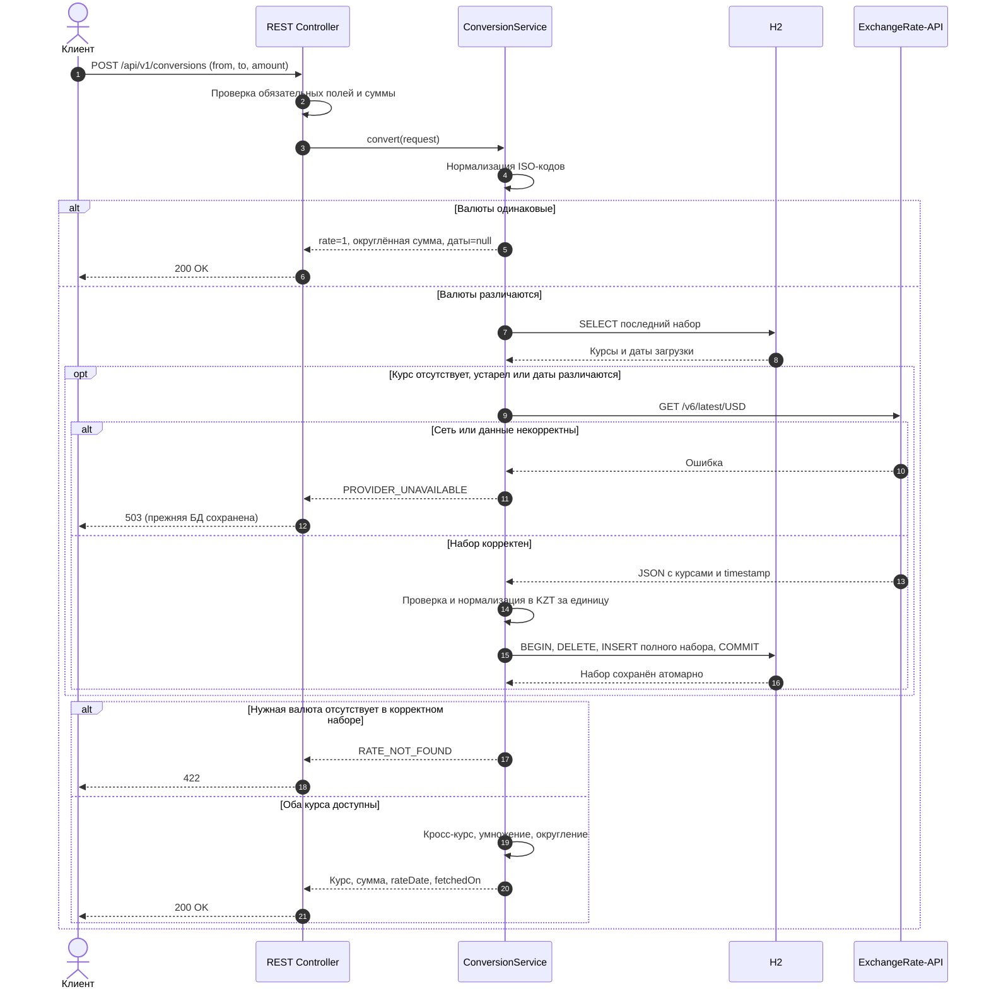

# Спецификация сервиса курсов валют

## 1. Назначение и принятые решения

Создать REST-сервис, который принимает валюту исходной суммы, целевую валюту и сумму; возвращает курс и результат конвертации. Поддержать ISO 4217: буквенные коды (`USD`, `KZT`) и цифровые коды в строковом формате (`840`, `398`). Допускается смешивание форматов в одном запросе.

Технологии: Java 21, Spring Boot 3.5.16, Maven, Spring MVC, Bean Validation, Spring JDBC, H2. Используется обычный SQL и `JdbcTemplate`, без ORM и дополнительных инфраструктурных сервисов.

Используются публичный ExchangeRate-API без ключа, файловая H2 и часовой пояс Asia/Almaty для определения календарного дня. Курсы обновляются при запросе, если актуальные данные отсутствуют. Источник возвращает единицы валюты за один USD; адаптер нормализует их в KZT за единицу для хранения и расчёта кросс-курсов. Основная валюта хранения — KZT. Это справочные курсы выбранного источника, без банковской комиссии.

Источники контракта: [ExchangeRate-API Open Access](https://www.exchangerate-api.com/docs/free) и [требования Spring Boot 3.5](https://docs.spring.io/spring-boot/3.5/system-requirements.html). Java 21 и Maven 3.8.1 удовлетворяют требованиям выбранной версии Spring Boot.

## 2. REST API

`POST /api/v1/conversions`, `Content-Type: application/json`.

```json
{
  "from": "USD",
  "to": "398",
  "amount": 100
}
```

| Поле | Тип | Правило |
| --- | --- | --- |
| `from` | string | Обязательное; буквенный или цифровой ISO-код; максимум 16 символов до удаления пробелов |
| `to` | string | Те же правила |
| `amount` | number | Обязательное; от 0 включительно; максимум 18 цифр до точки и 8 после точки |

Буквы приводятся к верхнему регистру, пробелы по краям удаляются. Цифровой код содержит ровно три ASCII-цифры, включая ведущие нули. Справочник валют берётся из `java.util.Currency` JDK 21. Неизвестные коды и немонетарные коды без дробных разрядов (например, `XXX`, `XAU`) отклоняются.

Успешный ответ `200 OK` (цифры ниже — учебный пример, не текущие котировки):

```json
{
  "from": "USD",
  "to": "KZT",
  "amount": 100,
  "rate": 500.0000000000,
  "convertedAmount": 50000.00,
  "rateDate": "2026-10-02",
  "fetchedOn": "2026-10-05"
}
```

`rate` — единиц целевой валюты за одну исходную, округлённый до 10 знаков. `rateDate` — UTC-дата последнего обновления набора из `time_last_update_unix` источника. `fetchedOn` — календарная дата успешной загрузки в часовом поясе приложения. Эти даты могут отличаться.

Если валюты совпадают после нормализации, курс равен 1; сумма округляется по целевой валюте; `rateDate` и `fetchedOn` равны `null`. БД и внешний сервис не вызываются: курс тождественного преобразования известен без котировок.

Отдельный endpoint для курса не нужен: передайте `amount: 1`, и получите и курс, и сумму. Исторические даты в запросе не поддерживаются.

## 3. Расчёт и точность

Все значения — `BigDecimal`, без `double` или `float`.

Источник публикует `rates[X]` — единицы валюты X за один USD. Адаптер вычисляет `kztPerUnit(X) = rates[KZT] / rates[X]` с 18 дробными знаками и `HALF_UP`. Например, при `rates[RUB]=90` и `rates[KZT]=500` в БД сохраняется `5.555555555555555556` KZT за RUB и `500` KZT за USD. JSON-числа читаются как `BigDecimal`, без промежуточного преобразования в `double`.

Для валют A и B: `rate(A → B) = kztPerUnit(A) / kztPerUnit(B)`. Для KZT нормализация даёт `kztPerUnit = 1`. USD и KZT обязательны в ответе источника; `rates[USD]` должен быть равен 1. RUB поддерживается как обычная необязательная валюта.

Деление и умножение используют `MathContext.DECIMAL128` (34 значащие цифры). Итоговая сумма округляется `HALF_UP` до `Currency.getDefaultFractionDigits()` целевой валюты: USD/KZT — 2 знака, JPY — 0, KWD — 3. Для расчёта суммы используется курс до округления до 10 знаков, чтобы округление отображаемого курса не накапливало ошибку на больших суммах.

Нулевая сумма допустима. Отрицательная сумма, слишком большое число и лишние дробные знаки дают `400`.

## 4. Хранение и актуальность

Таблица `exchange_rate` хранит только последний полностью загруженный набор:

| Колонка | Тип | Смысл |
| --- | --- | --- |
| `currency_code` | VARCHAR(3), PK | Буквенный код |
| `numeric_code` | VARCHAR(3), NOT NULL | Цифровой код с ведущими нулями |
| `kzt_per_unit` | DECIMAL(38,18), NOT NULL, CHECK > 0 | KZT за одну единицу |
| `rate_date` | DATE, NOT NULL | UTC-дата обновления набора из Unix timestamp |
| `fetched_on` | DATE, NOT NULL | Дата успешной загрузки |

Таблица создаётся идемпотентным `schema.sql`. При запуске со старой схемой он вычисляет `kzt_per_unit(X) = rub_per_unit(X) / rub_per_unit(KZT)` с округлением до 18 знаков, сохраняет коды и даты и удаляет старую колонку. Если старый набор не содержит KZT, кеш очищается для повторной загрузки по запросу. Повторный запуск не пересчитывает уже перенесённые котировки. Файлы H2 сохраняются в `./data/` и не попадают в Git. История котировок не хранится.

Алгоритм запроса:

1. Проверить поля, нормализовать оба ISO-кода.
2. При совпадении валют вернуть тождественное преобразование.
3. Прочитать набор из БД и найти обе валюты.
4. Если любой курс отсутствует, был загружен не сегодня или даты двух курсов различаются, запросить последний полный набор у источника.
5. Проверить JSON и все записи. Если ответ целиком корректен, одной транзакцией заменить набор в БД. HTTP-запрос выполняется до начала транзакции записи.
6. Если даже в новом наборе нет нужной валюты, вернуть `422 RATE_NOT_FOUND`. Валидный набор остальных валют при этом уже сохранён.
7. Рассчитать курс и сумму, вернуть обе даты.

Актуальность определяется `fetchedOn`, а не `rateDate`: повторный запрос использует уже загруженный сегодня набор. Endpoint возвращает последние курсы; параметр даты не передаётся. Открытый источник обновляется раз в сутки, поэтому это не котировки в реальном времени.

Первое обращение на конвертацию разных валют заполняет пустую БД. Если сохранённый набор устарел, следующий запрос выполняет загрузку актуальных данных.

При неуспешной загрузке старый набор остаётся в БД. Запрос с отсутствующим/устаревшим курсом получает `503`: старый курс не выдаётся как свежий. Следующий такой запрос повторяет загрузку.

## 5. Контракт внешнего источника

`GET https://open.er-api.com/v6/latest/USD`, без авторизации и параметров даты. Используются `result`, `base_code`, `time_last_update_unix` и объект `rates`:

```json
{
  "result": "success",
  "base_code": "USD",
  "time_last_update_unix": 1790899200,
  "rates": {"USD": 1, "RUB": 90, "KZT": 500}
}
```

Ответ должен иметь `result=success`, `base_code=USD`, положительный целочисленный timestamp с UTC-датой не позднее дня загрузки и обязательные котировки USD=1 и KZT>0. Коды должны состоять из трёх заглавных ASCII-букв, значения — быть положительными JSON-числами. Дублирующиеся ключи и лишние данные после JSON отклоняются. Нормализованное значение должно помещаться в колонку БД. Пустой ответ, HTML, повреждённый JSON, будущая дата, ошибка любого значения, HTTP-ошибка (включая 429), сбой соединения или таймаут дают `503 PROVIDER_UNAVAILABLE`; набор не сохраняется.

Источник также публикует коды, отсутствующие в ISO-справочнике JDK 21 (например, CNH). Котировки таких кодов и немонетарных валют исключаются после проверки формата и положительного числа. Цифровые коды поддерживаемых валют берутся из `java.util.Currency`.

Дата обновления может быть раньше дня загрузки; отдельное ограничение на её возраст не установлено. Эта дата явно возвращается клиенту. Котировки хранятся в KZT; уже сохранённый сегодня набор используется до следующего условия обновления.

Таймаут соединения — 3 секунды, чтения — 5 секунд. Автоматические повторные попытки внутри одного запроса не выполняются; следующий запрос может повторить загрузку. При отображении курсов на страницах приложения требуется атрибуция [Rates By Exchange Rate API](https://www.exchangerate-api.com). Кеширование данных разрешено условиями источника.

## 6. Ошибки API

Ошибки имеют формат Spring `ProblemDetail`, `Content-Type: application/problem+json`, поле `code` содержит устойчивый машинный код. Текст `detail` предназначен для диагностики, не является стабильным контрактом.

| HTTP | code | Условие |
| --- | --- | --- |
| 400 | `INVALID_REQUEST` | Нет обязательных полей, неверная сумма, повреждённый JSON или неверный тип поля |
| 400 | `INVALID_CURRENCY` | Код не распознан в ISO-справочнике JDK |
| 422 | `RATE_NOT_FOUND` | ISO-код валиден, но источник не публикует его курс |
| 503 | `PROVIDER_UNAVAILABLE` | Ошибка сети или некорректные данные источника |
| 503 | `DATABASE_UNAVAILABLE` | Ошибка чтения или записи БД |

Ошибки неизвестного URL или HTTP-метода обрабатываются стандартными механизмами Spring; таблица описывает бизнес-endpoint.

## 7. Sequence-диаграмма запроса



В ветке `503` обработка запроса завершается, расчёт не продолжается. При ошибке записи БД транзакция откатывается и возвращается `503 DATABASE_UNAVAILABLE`.

## 8. Простота и границы решения

Один исполняемый Maven-проект. Внедрение инфраструктурных зависимостей через конструктор, DTO как `record`, без Lombok. Интерфейс `RatesProvider` отделяет внешний источник от сервиса. `CurrencyResolver` и `ConversionCalculator` — обычные Java-классы без зависимостей от Spring; они проверяются чистым JUnit. `ConversionService` преобразует ошибку распознавания кода в HTTP-ошибку API.

`ConversionService` синхронизирует расчёт и обновление одним монитором внутри JVM. Это предотвращает параллельную замену набора при одновременных запросах одного экземпляра. Во время медленной загрузки остальные обращения к сервису ждут; это осознанное упрощение для небольшого приложения. Несколько экземпляров с общей БД не поддерживаются.

Нет авторизации, тарифов, комиссий, истории, очередей, Docker и административного REST API. Для PostgreSQL потребуются JDBC-драйвер и настройки, для высокой нагрузки — иной механизм согласования обновлений.

## 9. Критерии приёмки

- Сборка и тесты проходят на Java 21 командой `mvn clean verify`.
- Буквенные, цифровые и смешанные коды дают одинаковые результаты.
- Повторное обращение при наличии курсов, загруженных сегодня, не вызывает внешний сервис.
- Пустая БД, отсутствующий курс и устаревшие данные вызывают загрузку и сохранение.
- Курсы с датой публикации предыдущего рабочего дня, загруженные сегодня, используются повторно без обращения к источнику.
- Сбой источника или транзакции не уничтожает ранее сохранённый набор.
- Кросс-курс, ISO-коды и округление подтверждены минимальным набором юнит-тестов на чистом JUnit без моков и Spring Test.
- REST-контракт, нормализация котировок источника, актуальность и сохранность БД проверяются по ручным тест-кейсам.
- Для каждого юнит-теста в комментарии указаны связанный ручной кейс и причина выбора; обоснование набора описано отдельно.
